# Práctica AAA con RADIUS y NPS: Router, Switch y Servidor

**Omar Paulino - Matrícula 20251325**

## Video de demostración

[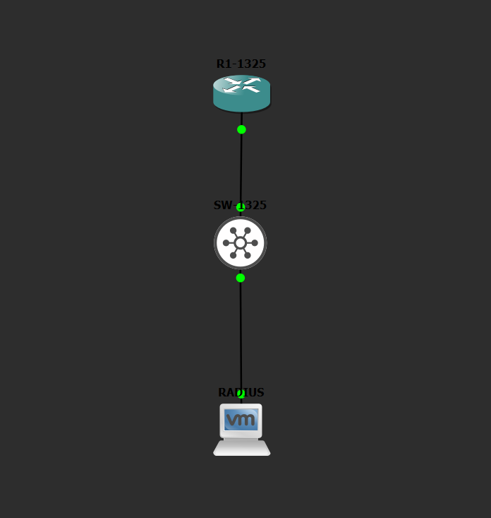](ENLACE_DEL_VIDEO)

**Enlace al video:** ENLACE_DEL_VIDEO

---

## Contenido

1. [Propósito del laboratorio](#1-propósito-del-laboratorio)
2. [Topología](#2-topología)
3. [Direccionamiento IP](#3-direccionamiento-ip)
4. [Credenciales, usuarios y niveles](#4-credenciales-usuarios-y-niveles)
5. [Equipos y versiones](#5-equipos-y-versiones)
6. [Router R1-1325](#6-router-r1-1325)
7. [Switch SW-1325](#7-switch-sw-1325)
8. [Servidor OMAR1325: Active Directory y NPS](#8-servidor-omar1325-active-directory-y-nps)
9. [Pruebas y resultados](#9-pruebas-y-resultados)
10. [Logs de autenticación, autorización y RADIUS](#10-logs-de-autenticación-autorización-y-radius)
11. [Running-configs y scripts](#11-running-configs-y-scripts)

---

## 1. Propósito del laboratorio

El objetivo de esta práctica es proteger el acceso administrativo a los equipos de red. Para eso centralicé la autenticación y la autorización en un servidor RADIUS (NPS de Windows Server) conectado a Active Directory. Así nadie entra al router ni al switch sin un usuario válido del dominio, y cada usuario recibe solo el nivel de privilegio que le corresponde según el grupo de AD al que pertenece.

### Requisitos y cómo los cumplí

| Requisito | Cómo lo cumplí |
|---|---|
| Seguridad en todos los niveles de autenticación y autorización | `aaa new-model`, listas de autenticación y autorización con nombre, `aaa authorization console`, `enable secret`, bloqueo tras intentos fallidos y `exec-timeout` en todas las líneas |
| Router y switch como clientes RADIUS | El router y el switch son clientes RADIUS del servidor 10.13.25.10: el router con `radius-server host` y el switch con `radius server NPS-1325`, porque el IOSvL2 solo acepta esa forma. En los dos, el servidor está dentro del grupo `GRUPO-NPS` y usa la clave compartida `Radius#1325` |
| Usuarios con privilegios distintos | Cada usuario entra con un nivel diferente según su grupo de AD: `nivel0-1325` en nivel 0 (solo comandos básicos), `nivel5-1325` en nivel 5 (monitoreo: `show`, `ping`, `traceroute`) y `nivel10-1325` en nivel 10 (puede configurar interfaces). El NPS envía el nivel con `Cisco-AV-Pair shell:priv-lvl` y el equipo lo aplica con `aaa authorization exec`. Los comandos de cada nivel se definieron con `privilege exec`, `privilege configure` y `privilege interface`. El nivel 15 solo se alcanza con `enable secret` o con el usuario local |
| Usuario local | `admin1325` con privilegio 15, que se usa como respaldo si el NPS no responde (método `local` al final de cada lista) |
| Autenticación y autorización en consola y auxiliar | Lista `CONSOLA-AUX` aplicada con `login authentication` y `authorization exec` en `line con 0` y `line aux 0` |
| Logs de autenticación, autorización y RADIUS | `login on-success/on-failure log`, `logging buffered`, `archive log config`, `aaa accounting exec` hacia el NPS, eventos 6272/6273 en Windows y archivo de contabilidad `IN2610.log` |
| SSH | SSH versión 2 con llave RSA de 2048 bits, solo desde la red de gestión (ACL `SSH-GESTION`), autenticado contra el NPS con la lista `VTY-SSH`. Decidí proteger también el SSH con AAA contra el NPS para cumplir con la seguridad en todos los niveles: así el acceso remoto respeta los mismos niveles por grupo de AD y queda registrado en el NPS. El usuario local `admin1325` sigue como respaldo en todas las líneas (consola, auxiliar y SSH) |
| Active Directory con grupos de nivel 0, 5 y 10 | OU `AAA-1325` con `GRP-NIVEL0-1325`, `GRP-NIVEL5-1325` y `GRP-NIVEL10-1325`, cada uno con su usuario |
| NPS | Rol NPAS instalado y registrado en AD, dos clientes RADIUS y tres directivas de red que devuelven `Cisco-AV-Pair shell:priv-lvl` |

---

## 2. Topología

### Topología en GNS3


La topología tiene tres equipos en línea: el router R1-1325 conectado al switch SW-1325, y el switch conectado al servidor Windows (nodo RADIUS en GNS3, máquina virtual de VMware).

### Diagrama lógico

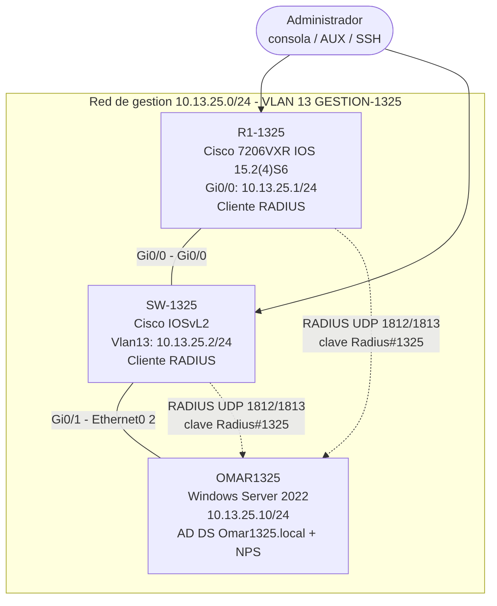

Los tres equipos están en la misma red de gestión, `10.13.25.0/24` (VLAN 13). El router y el switch envían las peticiones RADIUS al servidor por UDP 1812 (autenticación) y 1813 (contabilidad).

### Cómo se autentica un usuario

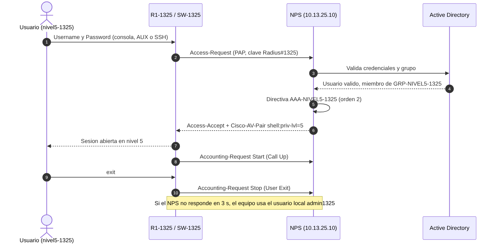

1. El usuario escribe su usuario y contraseña en la consola, el puerto auxiliar o por SSH.
2. El equipo envía un `Access-Request` al NPS con la clave compartida.
3. El NPS valida las credenciales contra Active Directory y revisa a qué grupo pertenece el usuario.
4. La primera directiva de red que coincide con el grupo responde `Access-Accept` con el atributo `Cisco-AV-Pair shell:priv-lvl=X`.
5. El equipo abre la sesión directamente en ese nivel y envía al NPS un registro de contabilidad de inicio. Al salir, envía otro de cierre.
6. Si el NPS no responde en 3 segundos, el equipo pasa al siguiente método de la lista: el usuario local.

---

## 3. Direccionamiento IP

La red se basa en mi matrícula 2025**1325**: los cuatro últimos dígitos forman la red `10.13.25.0/24`.

| Equipo | Interfaz | Dirección IP | Máscara | Gateway | VLAN |
|---|---|---|---|---|---|
| R1-1325 | GigabitEthernet0/0 | 10.13.25.1 | 255.255.255.0 | No aplica | No aplica |
| SW-1325 | Vlan13 | 10.13.25.2 | 255.255.255.0 | 10.13.25.1 | 13 |
| OMAR1325 (servidor) | Ethernet0 2 | 10.13.25.10 | 255.255.255.0 | 10.13.25.1 | 13 |

### Cableado

| Origen | Puerto | Destino | Puerto |
|---|---|---|---|
| R1-1325 | Gi0/0 | SW-1325 | Gi0/0 |
| SW-1325 | Gi0/1 | Servidor (RADIUS) | Ethernet0 2 |

### VLAN del switch

| VLAN | Nombre | Puertos |
|---|---|---|
| 13 | GESTION-1325 | Gi0/0, Gi0/1 |
| 999 | SIN-USO | Gi0/2, Gi0/3, Gi1/0 a Gi1/3 (apagados) |

---

## 4. Credenciales, usuarios y niveles

### Credenciales del laboratorio

| Dato | Valor |
|---|---|
| Dominio | Omar1325.local (NetBIOS `OMAR-1325`) |
| Usuario local de respaldo | `admin1325` / `Local#1325` (nivel 15) |
| Enable secret | `Enable#1325` |
| Clave compartida RADIUS | `Radius#1325` |

### Usuarios de Active Directory

| Usuario | Nombre | Contraseña | Grupo | Directiva NPS | Nivel |
|---|---|---|---|---|---|
| `nivel0-1325` | Usuario Nivel 0 | `N0#Lab2025!` | GRP-NIVEL0-1325 | AAA-NIVEL0-1325 | 0 |
| `nivel5-1325` | Usuario Nivel 5 | `N5#Lab2025!` | GRP-NIVEL5-1325 | AAA-NIVEL5-1325 | 5 |
| `nivel10-1325` | Usuario Nivel 10 | `N10#Lab2025!` | GRP-NIVEL10-1325 | AAA-NIVEL10-1325 | 10 |

### Qué puede hacer cada nivel

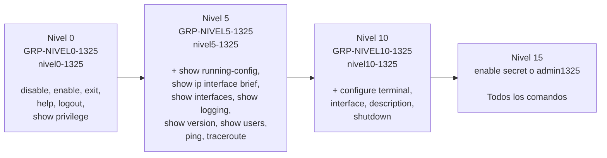

| Nivel | Comandos permitidos |
|---|---|
| 0 | `disable`, `enable`, `exit`, `help`, `logout`, `show privilege` |
| 5 | Lo del nivel 0 más `show running-config`, `show ip interface brief`, `show ip interface`, `show ip route`, `show interfaces`, `show logging`, `show version`, `show users`, `ping`, `traceroute` |
| 10 | Lo del nivel 5 más `configure terminal`, `interface`, `description`, `shutdown` |
| 15 | Todos los comandos. Solo se llega con `enable` + `Enable#1325`, o entrando con el usuario local |

---

## 5. Equipos y versiones

| Equipo | Plataforma | Software |
|---|---|---|
| R1-1325 | Cisco 7206VXR (NPE400), 512 MB de RAM, adaptador C7200-IO-GE-E | IOS 15.2(4)S6 ADVENTERPRISEK9 |
| SW-1325 | Cisco IOSvL2 | IOS 15.2 |
| OMAR1325 | VMware Workstation | Windows Server 2022 Standard (AD DS, DNS, NPS) |

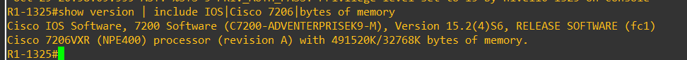

Los dos equipos Cisco tienen línea auxiliar (línea 1 AUX), que es necesaria para cumplir el requisito del puerto auxiliar:

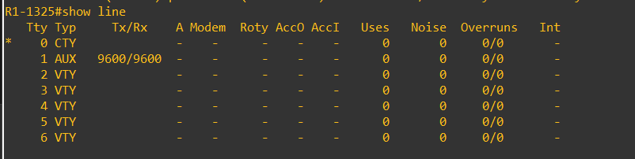

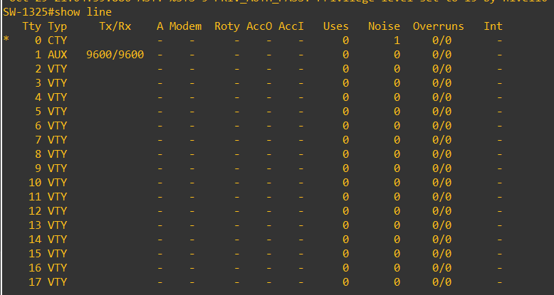

### Consola auxiliar en GNS3

GNS3 no asigna puerto de conexión al AUX del c7200 por defecto. Para habilitarlo, con el proyecto cerrado, edité el archivo `.gns3` y en el bloque del router, dentro de `"properties"`, agregué un puerto para el auxiliar (`"aux": 5100,`). Al abrir el proyecto de nuevo, el router tiene la opción **Auxiliary console** en el menú del clic derecho.

---

## 6. Router R1-1325

Toda la configuración está en [`scripts/router/R1-1325_configuracion.txt`](AAA-RADIUS-NPS/scripts/router/R1-1325_configuracion.txt). A continuación la explico por partes.

### 6.1 Configuración básica

```
enable
configure terminal
hostname R1-1325
no ip domain-lookup
ip domain-name omar1325.local
service password-encryption
service timestamps log datetime msec localtime show-timezone
service timestamps debug datetime msec localtime show-timezone
clock timezone AST -4 0
no ip source-route
no ip http server
no ip http secure-server

interface GigabitEthernet0/0
 description ENLACE-SW-1325-Gi0/0
 ip address 10.13.25.1 255.255.255.0
 no shutdown
exit
```

- `service password-encryption` cifra las contraseñas que quedan en texto plano en la configuración.
- Las marcas de tiempo con milisegundos y zona horaria permiten relacionar cada log con los eventos del servidor.
- Desactivé el servidor HTTP/HTTPS y el enrutamiento por origen porque no se usan y solo abren superficie de ataque.

### 6.2 Usuario local y seguridad del login

```
security passwords min-length 10
enable secret Enable#1325
username admin1325 privilege 15 secret Local#1325
login block-for 120 attempts 3 within 60
login delay 2
login on-failure log
login on-success log

banner motd ^
*** ACCESO RESTRINGIDO - R1-1325 - Solo personal autorizado ***
*** Practica AAA - Omar Paulino 20251325 ***
^
```

| Comando | Para qué sirve |
|---|---|
| `security passwords min-length 10` | Obliga a usar contraseñas de al menos 10 caracteres |
| `enable secret` | Contraseña cifrada (MD5) para subir a nivel 15 |
| `username admin1325 privilege 15 secret` | Usuario local de respaldo, con contraseña cifrada |
| `login block-for 120 attempts 3 within 60` | Si hay 3 intentos fallidos en 60 segundos, bloquea el login 120 segundos (protección contra fuerza bruta) |
| `login delay 2` | Espera 2 segundos entre intentos de login |
| `login on-failure log` / `on-success log` | Registra en el log cada login fallido y exitoso |
| `banner motd` | Mensaje de acceso restringido que se muestra antes de pedir usuario |

### 6.3 AAA y cliente RADIUS

```
aaa new-model
radius-server host 10.13.25.10 auth-port 1812 acct-port 1813 key Radius#1325
radius-server timeout 3
radius-server retransmit 1
ip radius source-interface GigabitEthernet0/0

aaa group server radius GRUPO-NPS
 server 10.13.25.10 auth-port 1812 acct-port 1813
 ip radius source-interface GigabitEthernet0/0
exit
```

- `aaa new-model` activa el modelo AAA. Desde este momento las líneas dejan de usar `password`/`login` y pasan a usar listas de métodos.
- El router es **cliente RADIUS** del servidor 10.13.25.10, con la clave compartida `Radius#1325`.
- `timeout 3` y `retransmit 1` hacen que, si el NPS no responde, el router pase rápido al usuario local.
- `ip radius source-interface` fija la IP de origen (10.13.25.1), que es la que el NPS tiene registrada como cliente.

### 6.4 Listas de autenticación, autorización y contabilidad

```
aaa authentication login default local
aaa authentication login CONSOLA-AUX group GRUPO-NPS local
aaa authentication login VTY-SSH group GRUPO-NPS local
aaa authentication enable default enable

aaa authorization console
aaa authorization exec default local
aaa authorization exec CONSOLA-AUX group GRUPO-NPS local
aaa authorization exec VTY-SSH group GRUPO-NPS local

aaa accounting exec default start-stop group GRUPO-NPS
aaa session-id common
```

| Lista | Tipo | Métodos | Dónde se aplica |
|---|---|---|---|
| `CONSOLA-AUX` | Autenticación y autorización | Primero NPS, luego local | `line con 0` y `line aux 0` |
| `VTY-SSH` | Autenticación y autorización | Primero NPS, luego local | `line vty 0 4` |
| `default` (enable) | Autenticación de enable | `enable secret` | Al escribir `enable` |
| `default` (accounting exec) | Contabilidad | NPS, inicio y fin | Todas las sesiones |

- **Autenticación:** comprueba quién es el usuario.
- **Autorización exec:** aplica el nivel que devuelve el NPS (`shell:priv-lvl`). Sin esta línea todos entrarían en nivel 1.
- `aaa authorization console`: sin este comando IOS no aplica autorización en la consola, aunque la línea tenga `authorization exec`.
- **Contabilidad:** envía al NPS un registro de inicio y otro de fin de cada sesión.

### 6.5 Niveles de privilegio

```
privilege exec level 0 show privilege
privilege exec level 5 show
privilege exec level 5 show interfaces
privilege exec level 5 show logging
privilege exec level 5 show running-config
privilege exec level 5 show version
privilege exec level 5 show users
privilege exec level 5 show ip
privilege exec level 5 show ip interface
privilege exec level 5 show ip interface brief
privilege exec level 5 show ip route
privilege exec level 5 ping
privilege exec level 5 traceroute
privilege exec level 10 configure
privilege exec level 10 configure terminal
privilege configure level 10 interface
privilege interface level 10 description
privilege interface level 10 shutdown
```

Con estos comandos cada nivel tiene solo lo necesario:

- **Nivel 5:** monitoreo, es decir, ver la configuración, las interfaces y los logs, y hacer pruebas de conectividad.
- **Nivel 10:** operación. Puede entrar a configurar interfaces, cambiar la descripción y apagarlas o encenderlas, pero no puede cambiar direcciones IP, el hostname, usuarios ni guardar la configuración.

### 6.6 SSH

```
crypto key generate rsa modulus 2048
ip ssh version 2
ip ssh time-out 60
ip ssh logging events

ip access-list standard SSH-GESTION
 permit 10.13.25.0 0.0.0.255
 deny   any log
exit

line vty 0 4
 access-class SSH-GESTION in
 transport input ssh
 transport output none
 login authentication VTY-SSH
 authorization exec VTY-SSH
 exec-timeout 5 0
 logging synchronous
exit
```

- Llave RSA de 2048 bits y solo SSH versión 2. Telnet queda desactivado con `transport input ssh`.
- La ACL `SSH-GESTION` solo permite conexiones desde la red de gestión y registra en el log cualquier otro intento.
- `ip ssh logging events` deja en el log cada sesión SSH abierta, autenticada y cerrada.

### 6.7 Consola y puerto auxiliar

```
line con 0
 privilege level 15
 login authentication CONSOLA-AUX
 authorization exec CONSOLA-AUX
 exec-timeout 5 0
 logging synchronous
exit
line aux 0
 privilege level 15
 login authentication CONSOLA-AUX
 authorization exec CONSOLA-AUX
 exec-timeout 5 0
 logging synchronous
exit
```

La consola y el auxiliar piden usuario y contraseña al NPS, y el nivel lo asigna la autorización (`authorization exec CONSOLA-AUX`) según el grupo de AD del usuario. `exec-timeout 5 0` cierra la sesión tras 5 minutos sin actividad.

### 6.8 Logs

```
logging userinfo
logging buffered 64000 informational
archive
 log config
  logging enable
  logging size 200
  notify syslog contenttype plaintext
  hidekeys
 exit
exit
end
write memory
```

- `logging buffered` guarda los logs en la memoria del router (64 KB).
- `logging userinfo` registra cuando un usuario cambia de nivel con `enable`.
- `archive log config` registra **cada comando de configuración, con el usuario que lo escribió**. `hidekeys` evita que las contraseñas aparezcan en ese registro.

---

## 7. Switch SW-1325

Toda la configuración está en [`scripts/switch/SW-1325_configuracion.txt`](AAA-RADIUS-NPS/scripts/switch/SW-1325_configuracion.txt). La parte de AAA es igual a la del router. Lo que cambia es la parte de capa 2 y la forma de declarar el servidor RADIUS.

### 7.1 Configuración básica, VLAN y puertos

```
enable
configure terminal
hostname SW-1325
no ip domain-lookup
ip domain-name omar1325.local
service password-encryption
service timestamps log datetime msec localtime show-timezone
service timestamps debug datetime msec localtime show-timezone
clock timezone AST -4 0
no ip http server
no ip http secure-server
no cdp run
spanning-tree mode rapid-pvst

vlan 13
 name GESTION-1325
vlan 999
 name SIN-USO
exit

interface GigabitEthernet0/0
 description ENLACE-R1-1325-Gi0/0
 switchport mode access
 switchport access vlan 13
 switchport nonegotiate
 spanning-tree portfast edge
 no shutdown
exit

interface GigabitEthernet0/1
 description SERVIDOR-NPS-OMAR1325
 switchport mode access
 switchport access vlan 13
 switchport nonegotiate
 switchport port-security
 switchport port-security mac-address sticky
 spanning-tree portfast edge
 spanning-tree bpduguard enable
 no shutdown
exit

interface range GigabitEthernet0/2 - 3, GigabitEthernet1/0 - 3
 description SIN-USO
 switchport mode access
 switchport access vlan 999
 shutdown
exit

interface Vlan1
 shutdown
exit
interface Vlan13
 description GESTION-SW-1325
 ip address 10.13.25.2 255.255.255.0
 no shutdown
exit
ip default-gateway 10.13.25.1
```

| Medida | Para qué sirve |
|---|---|
| `switchport mode access` + `nonegotiate` | Los puertos no negocian troncales (evita VLAN hopping por DTP) |
| `port-security mac-address sticky` en Gi0/1 | El puerto del servidor solo acepta la MAC del servidor (`000c.2915.9caa`), aprendida automáticamente |
| `bpduguard` en Gi0/1 | Si alguien conecta un switch en el puerto del servidor, el puerto se apaga |
| Puertos sin uso en la VLAN 999 y apagados | Nadie puede conectarse a un puerto libre y quedar en la red de gestión |
| `interface Vlan1` apagada | La VLAN por defecto no tiene IP |
| `no cdp run` | No anuncia información del equipo a los vecinos |

### 7.2 Usuario local y seguridad del login

```
enable secret Enable#1325
username admin1325 privilege 15 secret Local#1325
login block-for 120 attempts 3 within 60
login delay 2
login on-failure log
login on-success log

banner motd ^
*** ACCESO RESTRINGIDO - SW-1325 - Solo personal autorizado ***
*** Practica AAA - Omar Paulino 20251325 ***
^
```

### 7.3 AAA y cliente RADIUS

En el IOSvL2 declaré el servidor RADIUS con la sintaxis de servidor con nombre (`radius server`):

```
aaa new-model
radius server NPS-1325
 address ipv4 10.13.25.10 auth-port 1812 acct-port 1813
 key Radius#1325
exit
radius-server timeout 3
radius-server retransmit 1
ip radius source-interface Vlan13

aaa group server radius GRUPO-NPS
 server name NPS-1325
 ip radius source-interface Vlan13
exit

aaa authentication login default local
aaa authentication login CONSOLA-AUX group GRUPO-NPS local
aaa authentication login VTY-SSH group GRUPO-NPS local
aaa authentication enable default enable

aaa authorization console
aaa authorization exec default local
aaa authorization exec CONSOLA-AUX group GRUPO-NPS local
aaa authorization exec VTY-SSH group GRUPO-NPS local

aaa accounting exec default start-stop group GRUPO-NPS
aaa session-id common
```

### 7.4 Niveles de privilegio

Son los mismos del router (sección 6.5), excepto `show ip route`, porque el switch no enruta.

### 7.5 SSH, consola, auxiliar y logs

```
crypto key generate rsa modulus 2048
ip ssh version 2
ip ssh time-out 60
ip ssh logging events
ip ssh server algorithm encryption aes128-ctr aes192-ctr aes256-ctr
ip ssh client algorithm encryption aes128-ctr aes192-ctr aes256-ctr

ip access-list standard SSH-GESTION
 permit 10.13.25.0 0.0.0.255
 deny   any log
exit

line vty 0 15
 access-class SSH-GESTION in
 transport input ssh
 transport output none
 login authentication VTY-SSH
 authorization exec VTY-SSH
 exec-timeout 5 0
 logging synchronous
exit

line con 0
 login authentication CONSOLA-AUX
 authorization exec CONSOLA-AUX
 exec-timeout 5 0
 logging synchronous
exit
line aux 0
 login authentication CONSOLA-AUX
 authorization exec CONSOLA-AUX
 exec-timeout 5 0
exit

logging userinfo
logging buffered 64000 informational
archive
 log config
  logging enable
  logging size 200
  notify syslog contenttype plaintext
  hidekeys
 exit
exit
end
write memory
```

En el switch limité el cifrado de SSH a los algoritmos AES en modo CTR, que son más seguros que CBC. Las 16 líneas VTY (0 a 15) tienen la misma protección.

---

## 8. Servidor OMAR1325: Active Directory y NPS

Los scripts de PowerShell están en [`scripts/servidor/`](AAA-RADIUS-NPS/scripts/servidor). Todos se ejecutan en PowerShell como administrador.

### 8.1 Direccionamiento

Script: [`01_red.ps1`](AAA-RADIUS-NPS/scripts/servidor/01_red.ps1)

```powershell
New-NetIPAddress -InterfaceAlias "Ethernet0 2" -IPAddress 10.13.25.10 -PrefixLength 24 -DefaultGateway 10.13.25.1
Set-DnsClientServerAddress -InterfaceAlias "Ethernet0 2" -ServerAddresses 127.0.0.1
ipconfig /all
```

El servidor es controlador del dominio `Omar1325.local` y su propio DNS (127.0.0.1).

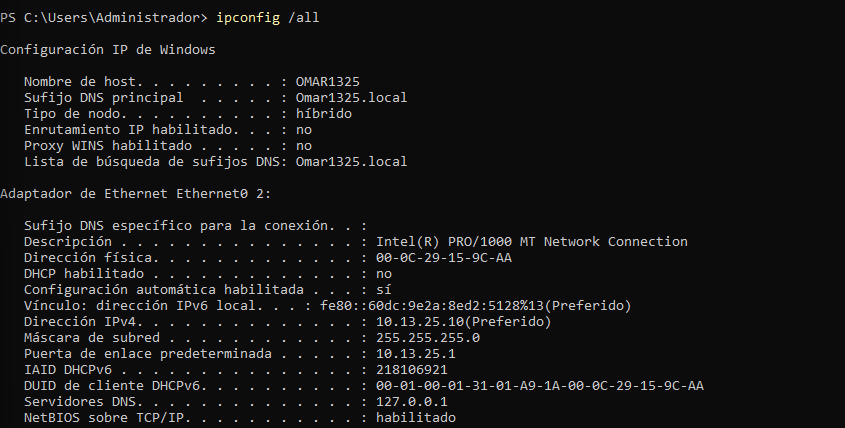

### 8.2 Active Directory: OU, grupos y usuarios

Script: [`02_active_directory.ps1`](AAA-RADIUS-NPS/scripts/servidor/02_active_directory.ps1)

```powershell
New-ADOrganizationalUnit -Name "AAA-1325" -Path "DC=Omar1325,DC=local"
$ou = "OU=AAA-1325,DC=Omar1325,DC=local"

New-ADGroup -Name GRP-NIVEL0-1325  -GroupScope Global -GroupCategory Security -Path $ou -Description "Privilegio 0 en router y switch"
New-ADGroup -Name GRP-NIVEL5-1325  -GroupScope Global -GroupCategory Security -Path $ou -Description "Privilegio 5 en router y switch"
New-ADGroup -Name GRP-NIVEL10-1325 -GroupScope Global -GroupCategory Security -Path $ou -Description "Privilegio 10 en router y switch"

New-ADUser -Name "Usuario Nivel 0"  -SamAccountName nivel0-1325  -UserPrincipalName nivel0-1325@Omar1325.local  -Path $ou -AccountPassword (ConvertTo-SecureString 'N0#Lab2025!'  -AsPlainText -Force) -Enabled $true -PasswordNeverExpires $true
New-ADUser -Name "Usuario Nivel 5"  -SamAccountName nivel5-1325  -UserPrincipalName nivel5-1325@Omar1325.local  -Path $ou -AccountPassword (ConvertTo-SecureString 'N5#Lab2025!'  -AsPlainText -Force) -Enabled $true -PasswordNeverExpires $true
New-ADUser -Name "Usuario Nivel 10" -SamAccountName nivel10-1325 -UserPrincipalName nivel10-1325@Omar1325.local -Path $ou -AccountPassword (ConvertTo-SecureString 'N10#Lab2025!' -AsPlainText -Force) -Enabled $true -PasswordNeverExpires $true

Add-ADGroupMember -Identity GRP-NIVEL0-1325  -Members nivel0-1325
Add-ADGroupMember -Identity GRP-NIVEL5-1325  -Members nivel5-1325
Add-ADGroupMember -Identity GRP-NIVEL10-1325 -Members nivel10-1325
```

Verificación de los miembros de cada grupo:

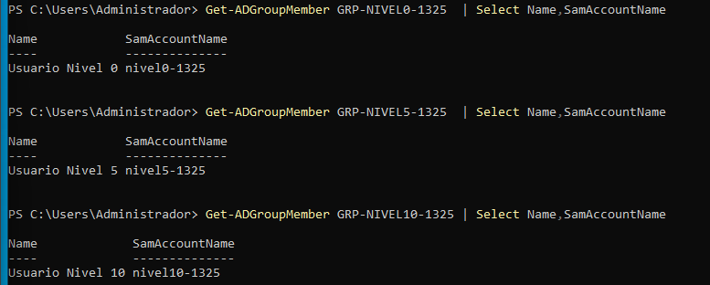

### 8.3 Instalación del NPS, registro en AD y clientes RADIUS

Script: [`03_nps.ps1`](AAA-RADIUS-NPS/scripts/servidor/03_nps.ps1)

```powershell
Install-WindowsFeature NPAS -IncludeManagementTools
netsh nps add registeredserver
New-NpsRadiusClient -Name "R1-1325" -Address 10.13.25.1 -SharedSecret "Radius#1325"
New-NpsRadiusClient -Name "SW-1325" -Address 10.13.25.2 -SharedSecret "Radius#1325"
Get-NpsRadiusClient
```

- `netsh nps add registeredserver` registra el NPS en Active Directory, para que pueda leer la información de acceso telefónico y los grupos de los usuarios. Es lo mismo que hacer clic derecho en **NPS (Local)** → **Registrar servidor en Active Directory**.
- Cada cliente RADIUS se identifica por su IP y usa la misma clave compartida que configuré en el equipo.

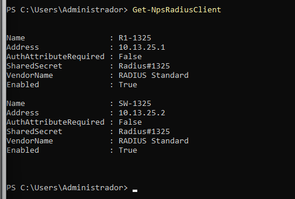

### 8.4 Directivas de red

En la consola **Servidor de directivas de redes** → **Directivas** → **Directivas de red** creé una directiva por nivel. El orden importa: el NPS evalúa de arriba hacia abajo y aplica la primera que coincide.

| Orden | Directiva | Condición (Grupo de Windows) | Autenticación | Cisco-AV-Pair |
|---|---|---|---|---|
| 1 | AAA-NIVEL10-1325 | OMAR-1325\GRP-NIVEL10-1325 | PAP | `shell:priv-lvl=10` |
| 2 | AAA-NIVEL5-1325 | OMAR-1325\GRP-NIVEL5-1325 | PAP | `shell:priv-lvl=5` |
| 3 | AAA-NIVEL0-1325 | OMAR-1325\GRP-NIVEL0-1325 | PAP | `shell:priv-lvl=0` |

Pasos para cada directiva (clic derecho en **Directivas de red** → **Nuevo**):

1. **Nombre** de la directiva y tipo de servidor de acceso a la red **Sin especificar**.
2. **Condiciones:** Agregar → **Grupos de Windows** → el grupo correspondiente.
3. **Permiso de acceso:** Acceso concedido.
4. **Métodos de autenticación:** solo **Autenticación sin cifrado (PAP, SPAP)**, que es el método que usa el IOS para el login. Las contraseñas no viajan en claro, porque RADIUS las oculta con la clave compartida.
5. **Configuración → Atributos RADIUS → Estándar:** quité `Framed-Protocol` y `Service-Type`, que son para conexiones de acceso remoto y no para administración de equipos.
6. **Configuración → Específico del proveedor:** Agregar → **Cisco-AV-Pair** → valor `shell:priv-lvl=X`.

**Directivas y sus condiciones:**

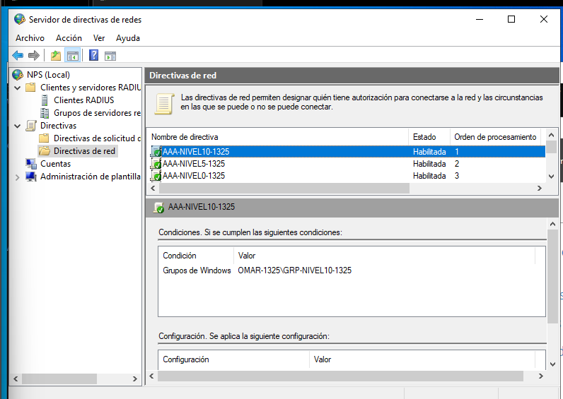

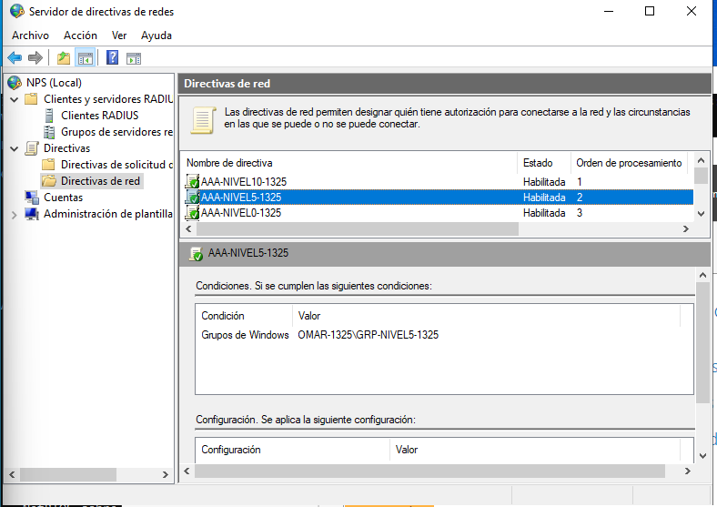

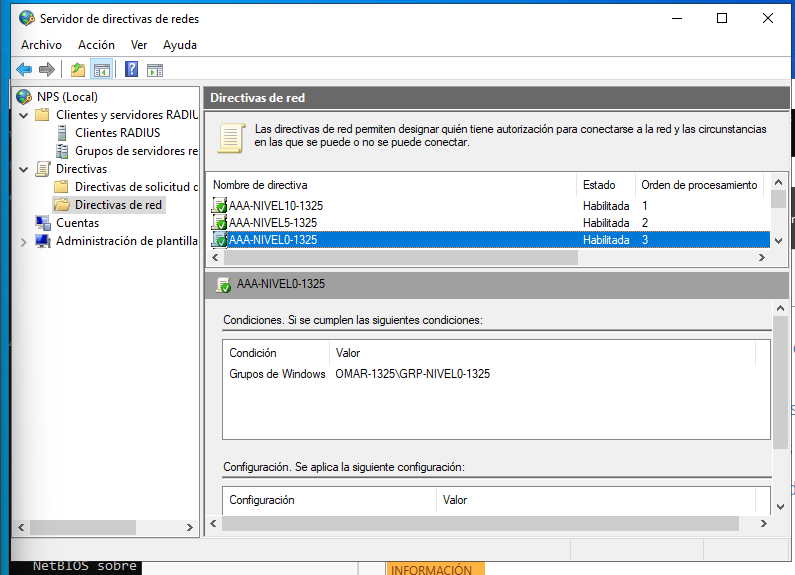

**Método de autenticación PAP en cada directiva:**

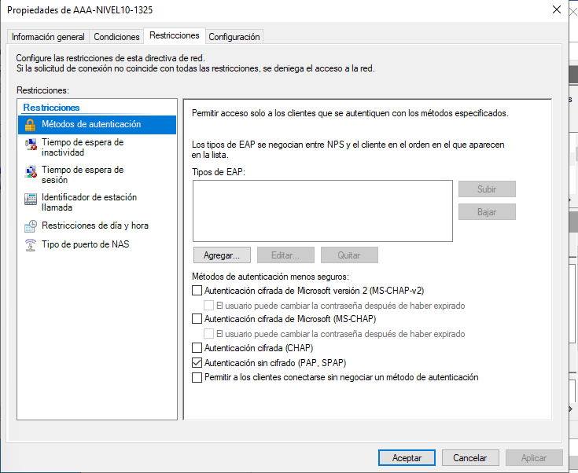

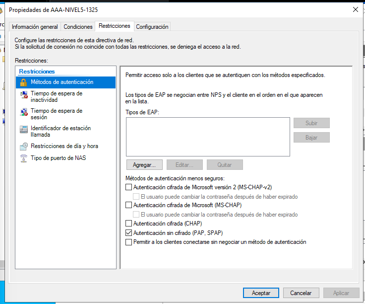

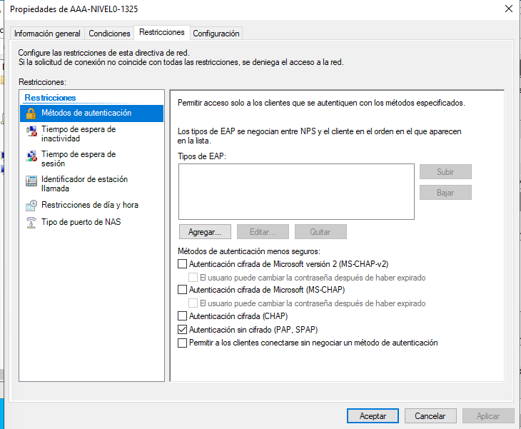

**Atributo Cisco-AV-Pair que define el nivel:**

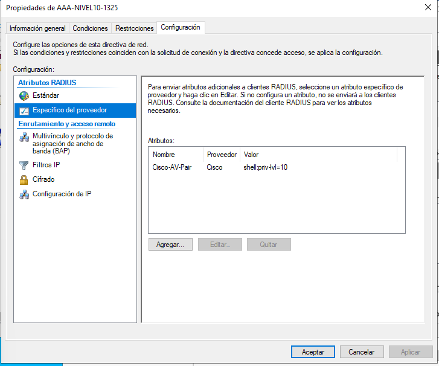

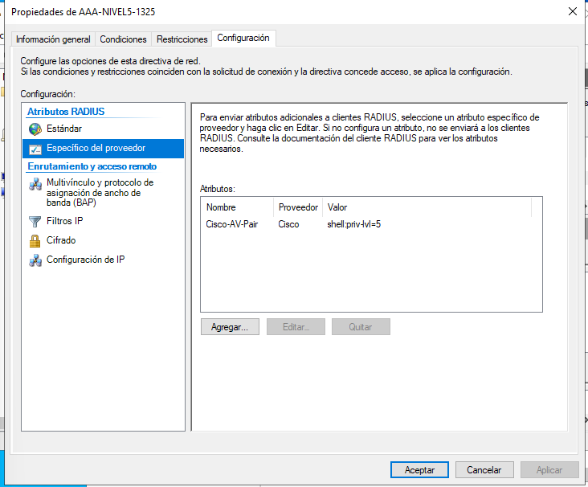

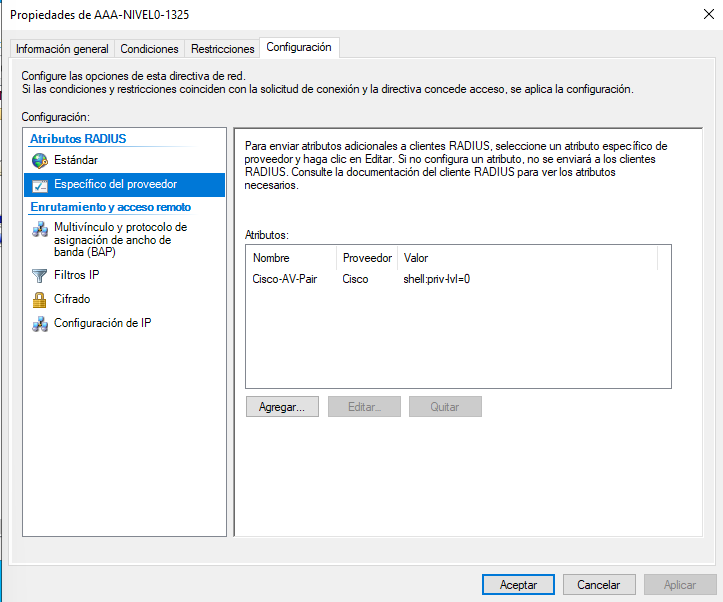

### 8.5 Contabilidad (Cuentas)

En la consola NPS → **Cuentas** → **Configurar cuentas** → **Registrar en un archivo de texto en el equipo local**. Dejé marcadas las solicitudes de cuentas, las de autenticación y los estados periódicos. El archivo se guarda en `C:\Windows\System32\LogFiles`, y se crea uno por mes (`IN2610.log` = octubre de 2026).

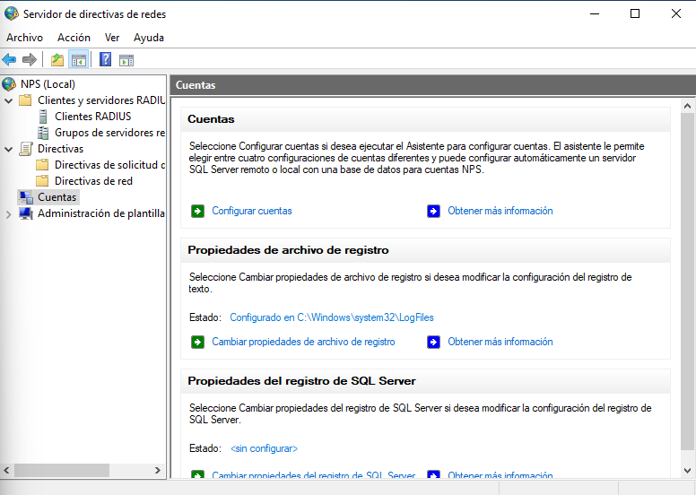

### 8.6 Auditoría y firewall

Script: [`04_auditoria_y_logs.ps1`](AAA-RADIUS-NPS/scripts/servidor/04_auditoria_y_logs.ps1)

```powershell
auditpol /set /subcategory:"Servidor de directivas de redes" /success:enable /failure:enable
auditpol /get /subcategory:"Servidor de directivas de redes"
Get-NetFirewallRule | Where-Object DisplayName -like "*RADIUS*" | Select DisplayName,Enabled
Restart-Service IAS -Force
```

Con la auditoría en **Aciertos y errores**, Windows registra el evento **6272** cuando el NPS concede acceso y el **6273** cuando lo niega.

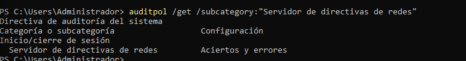

Las cuatro reglas del firewall de Windows para RADIUS (1812/1813 y las heredadas 1645/1646) están habilitadas:

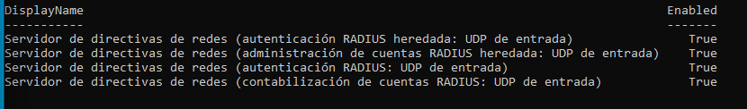

### 8.7 Exportación de la configuración del NPS

```powershell
netsh nps export filename="C:\NPS-1325.xml" exportPSK=YES
```

El archivo exportado está en [`running-configs/NPS-1325.xml`](AAA-RADIUS-NPS/running-configs/NPS-1325.xml). Contiene los clientes RADIUS, las directivas de red y la configuración de contabilidad.

---

## 9. Pruebas y resultados

### 9.1 Prueba directa contra el NPS desde el router

Con `test aaa` el router envía una petición RADIUS al servidor sin necesidad de cerrar la sesión. Los tres usuarios se autentican:

```
test aaa group radius nivel10-1325 N10#Lab2025! legacy
test aaa group radius nivel5-1325 N5#Lab2025! legacy
test aaa group radius nivel0-1325 N0#Lab2025! legacy
```

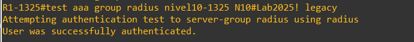

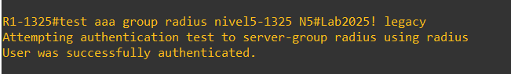

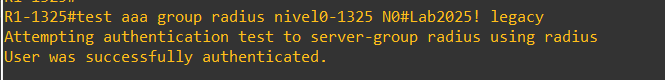

`show aaa servers` muestra el servidor 10.13.25.10 en estado **UP**, con los puertos 1812/1813 y sin peticiones perdidas:

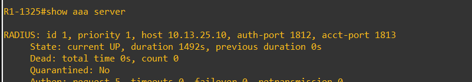

### 9.2 Nivel 0 en el router

Al entrar con `nivel0-1325`, el prompt queda en `>` y `?` muestra solo los comandos básicos del nivel 0. No puede ver ni configurar nada.

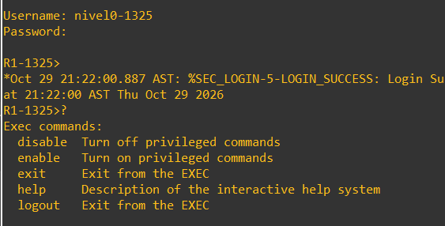

### 9.3 Nivel 5 en el router

`nivel5-1325` entra con `show privilege` = 5 y puede hacer `ping`, pero `configure terminal` da `Invalid input`: puede ver, pero no cambiar.

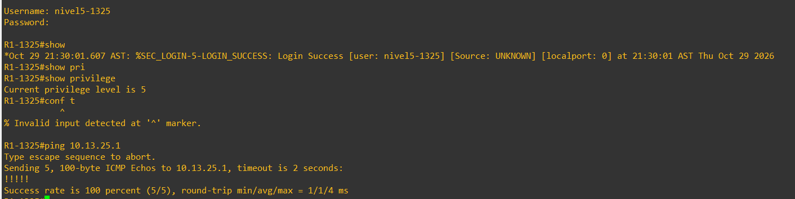

### 9.4 Nivel 10 en el router

`nivel10-1325` entra con nivel 10 y puede usar `configure terminal` e `interface`. Comandos de nivel 15 como `hostname` dan `Invalid input`. En la misma captura se ve el log `CFGLOG_LOGGEDCMD` con el usuario que ejecutó cada comando.

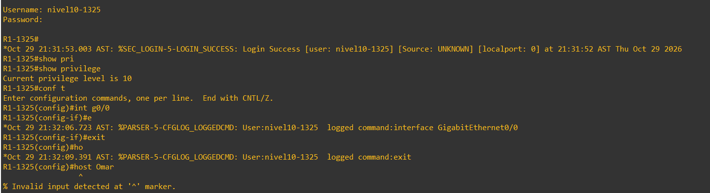

### 9.5 Subir a nivel 15 con enable

Para llegar a nivel 15 hace falta la contraseña `enable secret`, que no viene del NPS. El log registra `PRIV_AUTH_PASS` con el nombre del usuario que subió de nivel:

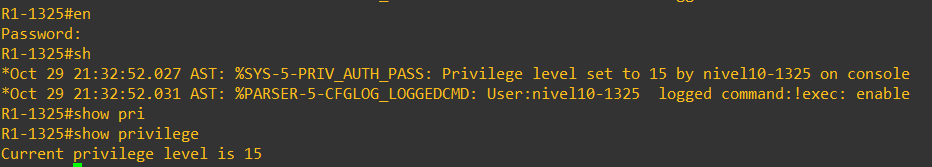

### 9.6 Login fallido

Con una contraseña incorrecta el acceso se rechaza:

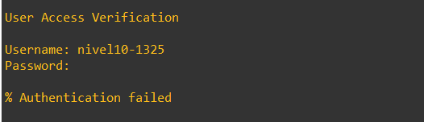

### 9.7 SSH desde el servidor

Desde PuTTY en el servidor (10.13.25.10) me conecté por SSH a R1. Se ve el banner y el usuario `nivel10-1325` entra con nivel 10, asignado por el NPS:

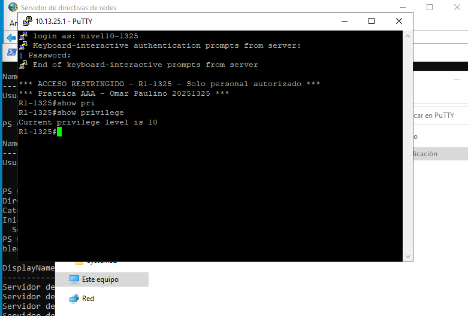

### 9.8 Respaldo con el usuario local

Detuve el servicio NPS para simular que el servidor no está disponible:

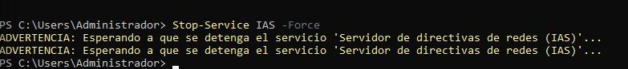

El router no recibe respuesta del NPS, pasa al método `local` de la lista y permite entrar con `admin1325`, que tiene nivel 15:

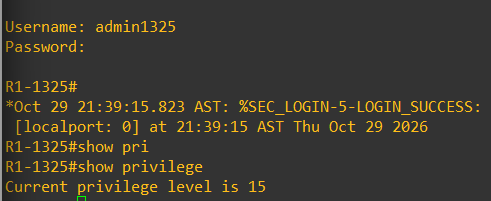

Después volví a iniciar el servicio con `Start-Service IAS`.

### 9.9 Acceso por el puerto auxiliar

Entré por la **consola auxiliar** de R1 con `nivel10-1325`. En `show line aux 0` la línea 1 AUX aparece marcada con `*` y en estado **Active**, que es la sesión en uso. También se ve el `exec-timeout` de 5 minutos:

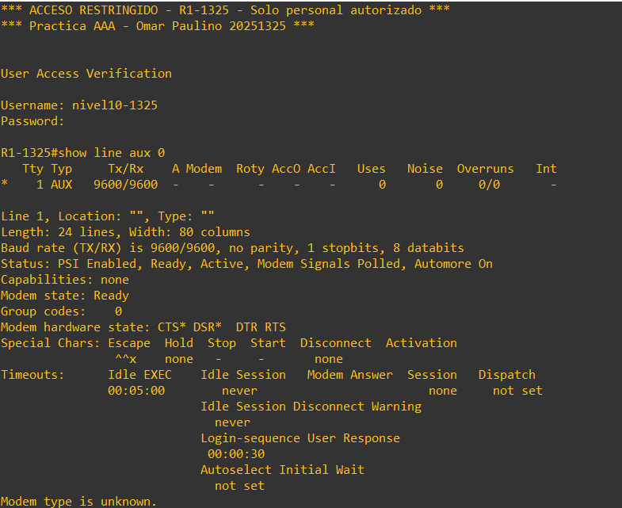

### 9.10 Pruebas en el switch

Los tres usuarios se autentican contra el NPS desde el switch:

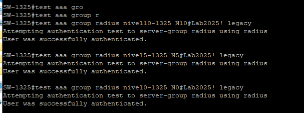

Cada usuario recibe su nivel en el switch:

| Usuario | Resultado |
|---|---|
| nivel0-1325 | Solo los comandos básicos |
| nivel5-1325 | `Current privilege level is 5` |
| nivel10-1325 | `Current privilege level is 10` |

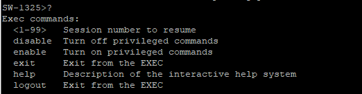

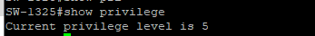

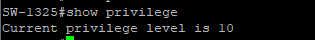

### 9.11 Resumen de resultados

| Prueba | R1-1325 | SW-1325 |
|---|---|---|
| `test aaa` con los 3 usuarios | Aceptados | Aceptados |
| nivel0-1325 recibe nivel 0 | Sí | Sí |
| nivel5-1325 recibe nivel 5 y no puede configurar | Sí | Sí |
| nivel10-1325 recibe nivel 10 y no puede usar comandos de nivel 15 | Sí | Sí |
| Subir a 15 solo con `enable secret` | Sí | Sí |
| Contraseña incorrecta rechazada | Sí | Sí |
| SSH autenticado contra el NPS | Sí | Sí |
| Usuario local cuando el NPS no responde | Sí | No aplica |
| Acceso por el puerto auxiliar con AAA | Sí | Configurado |

---

## 10. Logs de autenticación, autorización y RADIUS

### 10.1 Logs del router

`show logging` muestra cada evento de seguridad con fecha, hora, usuario y origen:

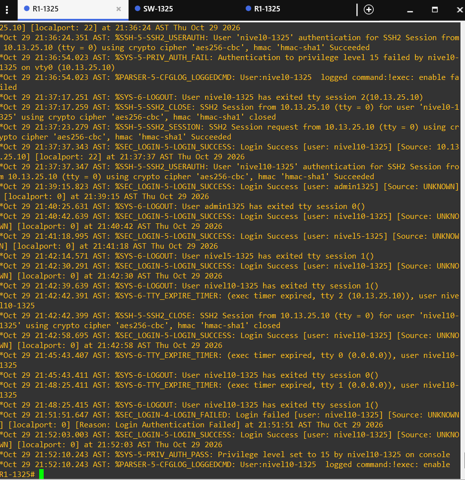

| Mensaje | Qué registra |
|---|---|
| `%SEC_LOGIN-5-LOGIN_SUCCESS` | Login correcto (autenticación), con usuario, IP de origen y puerto |
| `%SEC_LOGIN-4-LOGIN_FAILED` | Login fallido, con el motivo |
| `%SYS-5-PRIV_AUTH_PASS` / `PRIV_AUTH_FAIL` | Intento de subir de nivel con `enable`, exitoso o fallido (autorización) |
| `%SSH-5-SSH2_SESSION` / `SSH2_USERAUTH` / `SSH2_CLOSE` | Apertura, autenticación y cierre de cada sesión SSH, con el cifrado usado |
| `%SYS-6-LOGOUT` | Cierre de sesión |
| `%SYS-6-TTY_EXPIRE_TIMER` | Sesión cerrada por inactividad (`exec-timeout`) |
| `%PARSER-5-CFGLOG_LOGGEDCMD` | Comando de configuración ejecutado y quién lo escribió |

`show archive log config all` muestra el historial de comandos con el usuario y la línea desde donde se ejecutaron. Por ejemplo, se ve `nivel0-1325@vty0` con `enable failed`: el usuario de nivel 0 intentó subir a 15 por SSH y no lo logró.

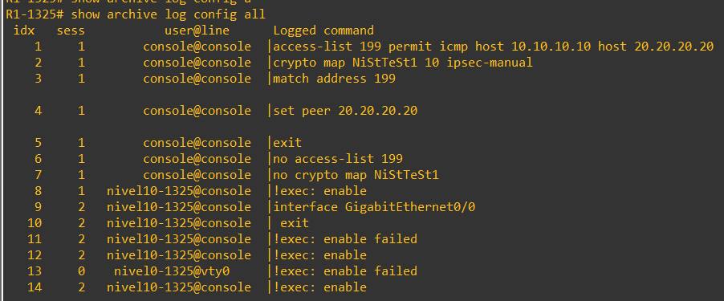

### 10.2 Logs del switch

En el switch se ven las sesiones SSH de los tres usuarios desde el servidor, un login fallido y los cambios de nivel:

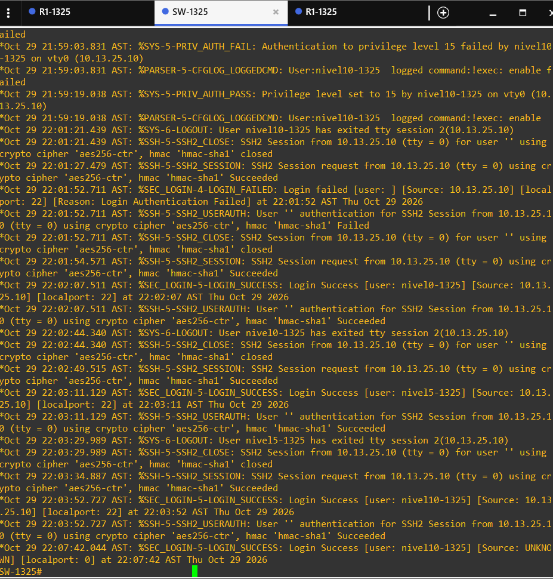

### 10.3 Eventos del NPS en el Visor de eventos

En **Visor de eventos → Vistas personalizadas → Roles de servidor → Servicios de acceso y directivas de redes** están todos los eventos del NPS.

**Evento 6272:** el servidor de directivas de redes concedió acceso a un usuario. Al bajar en la descripción del evento aparecen el usuario, el cliente RADIUS (R1-1325 o SW-1325) y la directiva de red que se aplicó.

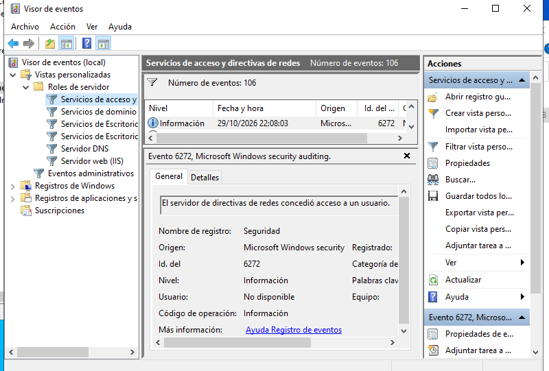

**Evento 6273:** el servidor de directivas de redes denegó el acceso a un usuario. La descripción del evento indica el motivo del rechazo.

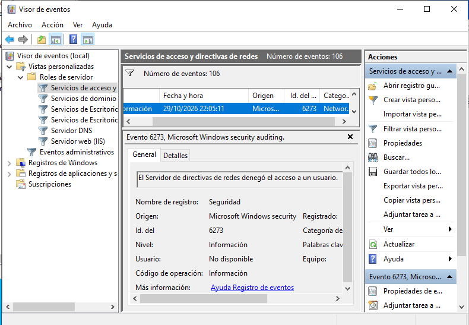

### 10.4 Archivo de contabilidad RADIUS

`C:\Windows\System32\LogFiles\IN2610.log` registra cada paquete RADIUS que recibe el NPS, con el usuario (`User-Name`), el equipo que lo envió (`NAS-IP-Address`: 10.13.25.1 para R1, 10.13.25.2 para el switch) y el tipo de paquete:

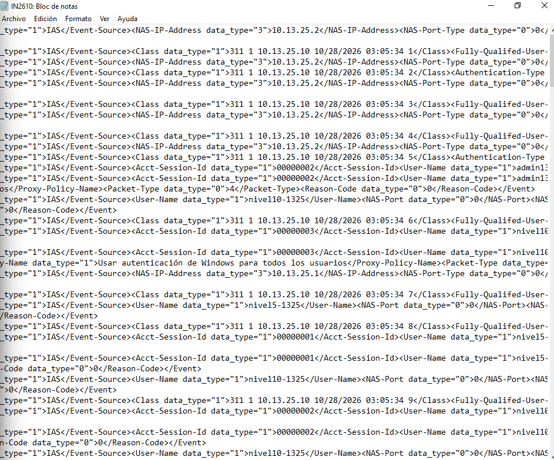

| Packet-Type | Significado |
|---|---|
| 1 | Access-Request: el equipo pregunta por el usuario |
| 2 | Access-Accept: el NPS aceptó |
| 3 | Access-Reject: el NPS rechazó |
| 4 | Accounting-Request: inicio (`Call Up`) o fin (`User Exit`) de una sesión |

---

## 11. Running-configs y scripts

### Running-configs

| Archivo | Equipo |
|---|---|
| [`R1-1325_running-config.txt`](AAA-RADIUS-NPS/running-configs/R1-1325_running-config.txt) | Router R1-1325 (`show running-config`) |
| [`SW-1325_running-config.txt`](AAA-RADIUS-NPS/running-configs/SW-1325_running-config.txt) | Switch SW-1325 (`show running-config`) |
| [`NPS-1325.xml`](AAA-RADIUS-NPS/running-configs/NPS-1325.xml) | Configuración exportada del NPS |

### Scripts

| Archivo | Descripción |
|---|---|
| [`router/R1-1325_configuracion.txt`](AAA-RADIUS-NPS/scripts/router/R1-1325_configuracion.txt) | Configuración completa del router |
| [`switch/SW-1325_configuracion.txt`](AAA-RADIUS-NPS/scripts/switch/SW-1325_configuracion.txt) | Configuración completa del switch |
| [`servidor/01_red.ps1`](AAA-RADIUS-NPS/scripts/servidor/01_red.ps1) | Direccionamiento del servidor |
| [`servidor/02_active_directory.ps1`](AAA-RADIUS-NPS/scripts/servidor/02_active_directory.ps1) | OU, grupos y usuarios de AD |
| [`servidor/03_nps.ps1`](AAA-RADIUS-NPS/scripts/servidor/03_nps.ps1) | Instalación del NPS, registro y clientes RADIUS |
| [`servidor/04_auditoria_y_logs.ps1`](AAA-RADIUS-NPS/scripts/servidor/04_auditoria_y_logs.ps1) | Auditoría, firewall, eventos y exportación |
| [`pruebas_router_switch.txt`](AAA-RADIUS-NPS/scripts/pruebas_router_switch.txt) | Comandos de verificación usados en las pruebas |
